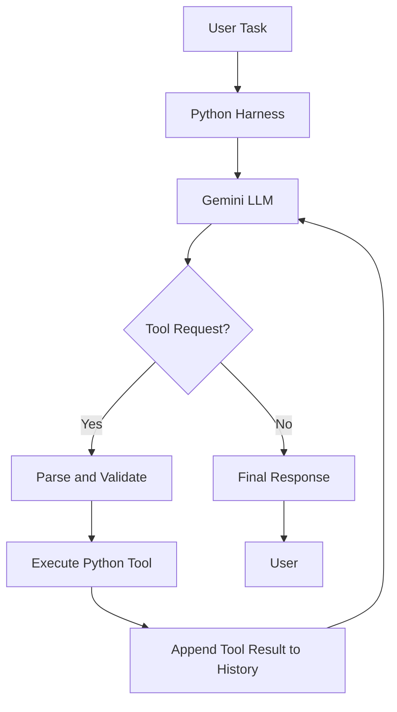

# Building an LLM Harness/Coding Agent from Scratch with Python and Gemini

A simple, educational implementation of an AI coding agent that demonstrates how an **LLM harness/Coding Agent works under the hood**.

Instead of using Gemini's native function-calling feature, this project implements text-based tool calling using Python. Gemini generates a tool request in a predefined text format, and Python parses the request, executes the corresponding function, and sends the result back to the model.

The goal is to understand the core mechanics behind agentic systems—not to hide them behind an agent framework.

## Overview

An LLM can generate responses, but performing tasks such as reading files, creating source code, and editing existing files requires additional software infrastructure.

An LLM harness coordinates the interaction between the model, tools, conversation history, and execution flow.

This project implements a lightweight coding agent using the Gemini API and Python.

### How it works

1. The user provides a task in natural language.
2. The harness sends the conversation and system instructions to Gemini.
3. Gemini either generates a normal response or requests a tool using a predefined text format.
4. The harness parses the tool request and validates its arguments.
5. The corresponding Python function executes the requested operation.
6. The tool result is added to the conversation history and sent back to Gemini.
7. The cycle continues until the model produces a final response or an execution limit is reached.

## Architecture



## Features

- **Text-based tool calling:** Implements tool invocation without Gemini's native function-calling mechanism.
- **Tool registry:** Maps tool names to Python functions.
- **Automatic tool descriptions:** Uses Python's `inspect` module to derive tool signatures and docstrings for the system prompt.
- **Argument validation:** Validates tool arguments before execution.
- **Workspace isolation checks:** Prevents file operations from targeting paths outside the configured workspace.
- **Conversation history:** Maintains context across model calls within a conversation.
- **Iterative execution:** Feeds tool results back to the model so it can decide what to do next.
- **Execution limits:** Limits tool calls and agent steps to reduce the risk of unbounded loops.
- **Environment-based configuration:** Loads API credentials and configuration from environment variables.

## Available Tools

| Tool | Description |
|---|---|
| `read_file` | Reads the contents of a file in the workspace. |
| `list_files` | Lists files and directories in the workspace. |
| `create_file` | Creates a file within the workspace. |
| `edit_file` | Replaces the first occurrence of a specified text fragment in a file. |

Tool descriptions are generated programmatically from the registered Python functions rather than being maintained entirely by hand.

## Text-Based Tool Calling

The model is instructed to return tool requests in a predefined format, for example:

```text
tool: create_file({"file_path":"hello.py","content":"print('Hello World')"})
```

The harness extracts the tool name and JSON arguments, looks up the corresponding Python function, validates the request, and executes it.

After execution, the result is added to the conversation as a text message, such as:

```text
tool_result(Successfully created: hello.py)
```

Gemini receives this result as part of the conversation and can use it to decide its next action.

**Important:** This is a custom text-parsing protocol. The model is not returning a structured Gemini function-call object. The Python harness is responsible for interpreting the text and executing the requested operation.

## Project Structure

The following is a conceptual representation of the components:

```text
coding_agent/
├── coding_agent.py    # Agent and execution loop
├── .env               # Local environment configuration
├── .gitignore
└── agent_workspace/   # Files accessible to the agent
```

The exact structure may differ depending on the repository's implementation.

## Getting Started

See the repository for the source code and project requirements.

## Example Usage

Start the agent and enter a task such as:

```text
Create a Python file called hello.py that prints Hello World.
```

The interaction follows this general sequence:

```text
User:
Create a Python file called hello.py that prints Hello World.

Gemini:
tool: create_file({"file_path":"hello.py","content":"print('Hello World')"})

Harness:
Executes create_file() inside the workspace.

Tool Result:
Successfully created: hello.py

Gemini:
The file hello.py has been created successfully.
```

The exact wording of model responses may vary.

## Understanding the Implementation

### The LLM

Gemini interprets the user's request and decides whether to answer directly or request a tool.

### The Tool Registry

The registry maps tool names to callable Python functions. This allows the harness to dispatch requests dynamically instead of using a long sequence of hard-coded conditionals.

### The Tool Parser

The parser extracts the tool name and arguments from the model's text response. Unlike native function calling, this requires custom parsing and validation.

### The Orchestrator

The `run_turn()` method coordinates the agent's execution loop. It manages model calls, tool execution, tool-result feedback, and stopping conditions.

### Conversation History

Previous user messages, model responses, and tool results provide context for subsequent model calls.

### Workspace Validation

The path-resolution utility resolves requested paths and verifies that they remain inside the configured workspace. This helps prevent unintended file access outside the project directory.

## Limitations

This project is an educational prototype, not a production-ready autonomous coding environment.

- Text-based tool calling depends on the model following the expected output format.
- Parsing failures and malformed arguments must be handled explicitly.
- Exact text replacement can fail if the requested text does not match the file contents.
- Workspace path checks do not provide complete operating-system-level isolation.
- File operations are not a substitute for a sandbox, permission system, or human approval workflow.
- Model outputs and generated code should be reviewed before being trusted or executed.
- API usage may incur costs depending on the selected model and account.

## What You Can Learn

By exploring this implementation, you can understand:

- What an LLM harness is and why it is needed.
- How an agent's tool-calling loop works.
- How an LLM can use external Python functions.
- How tool registries and dynamic dispatch work.
- How conversation history enables iterative execution.
- Why input validation, execution limits, and workspace boundaries matter.
- How a basic coding agent can be built without an agent framework.

## Tech Stack

- **Language:** Python
- **LLM:** Google Gemini
- **SDK:** Google Gen AI SDK
- **Configuration:** `python-dotenv`
- **Tool invocation:** Custom text-based protocol
- **Filesystem operations:** Python standard library

## Further Improvements

Possible extensions include adding more tools, structured output validation, retry logic, command execution in a sandbox, human approval before file modifications, and automated testing of generated code.

## Author

**Aditya — Adi Explains**

This project is part of an educational exploration of LLMs, AI agents, and the engineering systems that make them useful.

GitHub: https://github.com/AdityaTheDev/AdiExplains

If you find this project useful for learning, consider starring the repository.
